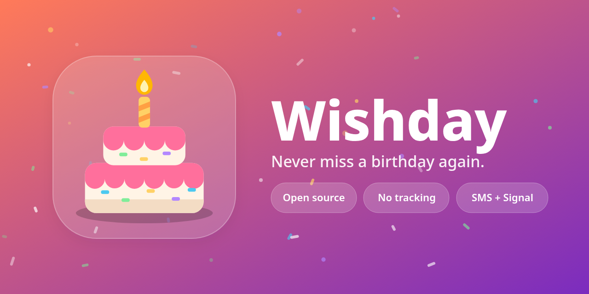

# Wishday 🎂



A small, open-source Android app that remembers birthdays and helps you wish people a happy birthday, by **SMS (fully automatic)** or **Signal (prefilled, one tap)**.

Inspired by [Birday](https://github.com/m-i-n-a-r/birday).

## Features

- Import birthdays from your phone's contacts, or add them by hand (birth year optional)
- A list sorted by whose birthday is next, showing the age they're turning
- Choose what happens on each person's birthday:
  - **Remind me**: a notification, nothing is sent
  - **Auto SMS**: Wishday sends the text itself at your chosen time
  - **Signal**: a notification that opens Signal with the message already typed; you tap send
- A default message template with `{name}`, `{fullname}` and `{age}` placeholders, plus per-person overrides
- An optional reminder 1–14 days ahead
- Failed texts are retried automatically (up to 3 more times, 15 minutes apart), and you're told whether each one really went out
- Export and import birthdays as CSV, for backups, moving phones, spreadsheets, or bringing them in from another app
- Import a [Birday](https://github.com/m-i-n-a-r/birday) backup directly, to switch over in one step
- People born on Feb 29 are celebrated on Feb 28 in non-leap years
- No internet permission, no accounts, no tracking. Everything stays on the device.

## Why Signal isn't fully automatic

Signal has no public API, and other apps can't send messages through it. Wishday does the closest thing it can: it opens Signal's `smsto:` handler so the right chat opens with the draft filled in. If that handler isn't available, it falls back to Signal's share sheet, where you pick the contact.

If you want fully automatic Signal sending, the usual route is [signal-cli](https://github.com/AsamK/signal-cli) linked as a secondary device on an always-on machine. Adding that as an optional backend is a good candidate for a future contribution.

## Why this isn't on Google Play

Automatic SMS needs the `SEND_SMS` permission. Google Play only allows that permission for apps set as the device's default SMS app. Wishday is meant for [F-Droid](https://f-droid.org) and GitHub releases, where that restriction doesn't apply. Store metadata is in `fastlane/metadata/android`.

## How it works

| Piece | File |
|---|---|
| Room database of people | `data/Person.kt`, `data/PersonDao.kt` |
| Date math and message templating | `birthday/Birthdays.kt` |
| Contact import | `contacts/ContactImporter.kt` |
| SMS sending | `messaging/SmsSender.kt` |
| SMS results and retries | `messaging/SmsResultReceiver.kt`, `work/SmsRetryWorker.kt` |
| CSV export and import | `backup/BirthdayCsv.kt` |
| Birday backup import | `backup/BirdayBackup.kt` |
| Opening Signal | `messaging/SignalLauncher.kt` |
| Daily check (WorkManager) | `work/BirthdayWorker.kt` |
| Compose UI | `ui/` |

Once a day, at the send time you choose (9:00 by default), `BirthdayWorker` checks who has a birthday. It sends SMS, posts the Signal prompts and reminders, records that each person was greeted that year, and schedules the next run. If the phone was off at the send time, the check runs the next time the app is opened that day. People are never greeted twice in one year.

## Building

```sh
./gradlew assembleDebug        # app/build/outputs/apk/debug/app-debug.apk
./gradlew testDebugUnitTest    # unit tests
```

Requires Android 8.0 (API 26) or newer.

## License

[GPL-3.0-or-later](LICENSE)

Made by [Daniel Stuckless](https://stuckless.net).
